<h1 align="center">Pile Sprint</h1>

<p align="center">
  <b>Clear any pile, one card at a time.</b><br>
  Emails, photos, applicants, rows in a spreadsheet. Right keeps, left drops, down leaves it for later.<br>
  Nothing changes until you press Save.
</p>

<p align="center">
  <a href="https://github.com/tania-atomichr/pile-sprint/actions/workflows/test.yml"></a>
  <a href="LICENSE"></a>
  
  
</p>

<p align="center">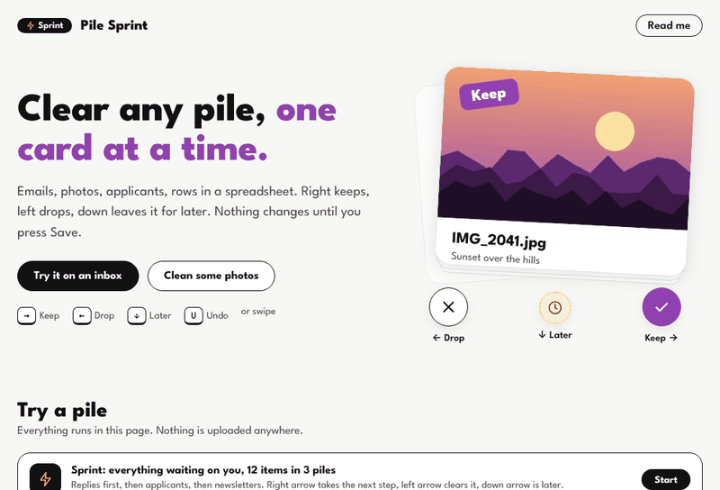</p>

## Why use it

| | |
|---|---|
| **Fast** | One card, three answers, a key or a swipe each. A pile of 50 takes a few minutes. |
| **Send from the card** | When the card carries words (a reply, a follow-up), right sends them with 3 seconds to undo, and the next card is already up. Drafts are written for the next cards while you read this one. |
| **Safe** | Nothing happens to the pile until Save. Undo any press. Close early and it asks whether to save what you decided. Files are moved, never deleted. |
| **The whole thing on the card** | The full message, the full picture, a score, a checklist of what was asked, the conversation so far, every column of the row. No opening and closing tabs. |
| **Any pile** | An array, a CSV, a folder of photos, or a URL on your own server. Each kind of item can have its own words ("Answer" and "Nothing to answer" for replies, "Keep" and "Unsubscribe" for newsletters). |
| **Yours to connect** | Your code gets the answers: call your API per item, post them all to a webhook, move files, or download a list. |
| **Easy to change** | Plain JavaScript and CSS, three files, no dependencies, no build step. MIT licence. |

Good for clearing an inbox, cleaning a photo folder, screening applicants or
leads, triaging tickets, reviewing orders or content before it goes out, and
any other "look at each one and decide" job.

## Quick start

**Try it:** download the code (green **Code** button, then **Download ZIP**),
unzip it, and open `index.html` in your browser. Press **Try it on an
inbox**.

**Put it in your page:**

```html
<link rel="stylesheet" href="src/pile-sprint.css">
<script src="src/core.js"></script>
<script src="src/pile-sprint.js"></script>
<script>
  PileSprint.open({
    title: "Leads to qualify",
    items: leads.map(l => ({ id: l.id, title: l.name, subtitle: l.company, body: l.note })),
    kinds: { default: { keep: "Call them", drop: "Not a fit" } },
    save: {
      keep: lead => fetch(`/api/leads/${lead.id}/call`, { method: "POST" }).then(r => r.ok),
      drop: lead => fetch(`/api/leads/${lead.id}/archive`, { method: "POST" }).then(r => r.ok)
    }
  }).then(result => console.log(result.saved, result.failed));
</script>
```

Add `src/sources.js` and `src/destinations.js` when you want the ready-made
ways in and out described below.

## Contents

- [What it looks like](#what-it-looks-like)
- [Everything it does](#everything-it-does)
- [Keys and swipes](#keys-and-swipes)
- [Items](#items) and [options](#options)
- [Where a pile comes from](#where-a-pile-comes-from)
- [Where the answers go](#where-the-answers-go), including [Google Sheets](#google-sheets)
- [The `pile-sprint/1` format](#the-pile-sprint1-format)
- [Privacy](#privacy), [How it is built](#how-it-is-built) and [Test](#test)
- [Contributing](#contributing)

## What it looks like

Every picture here comes from the made-up piles on the demo page.

**A start bar** opens one sprint over several piles, in the order you choose:

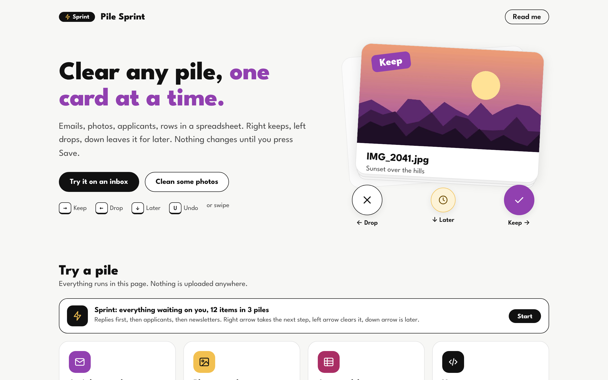

**A message** shows all of its words, and the draft written for it while you
were on the card before. Change anything in the box. The answers carry the
words of its kind: a reply asks "Send" or "Nothing to answer".

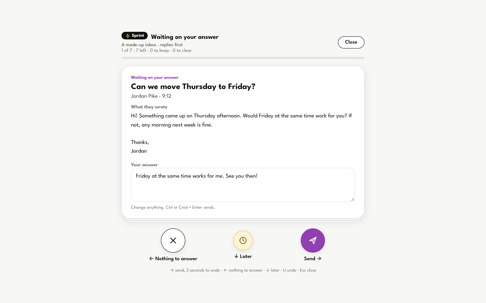

**Send waits 3 seconds**, with Undo, while the next card is already on
screen. A right never sends words you could not see: if the box runs past
the card, the first press shows all of it.

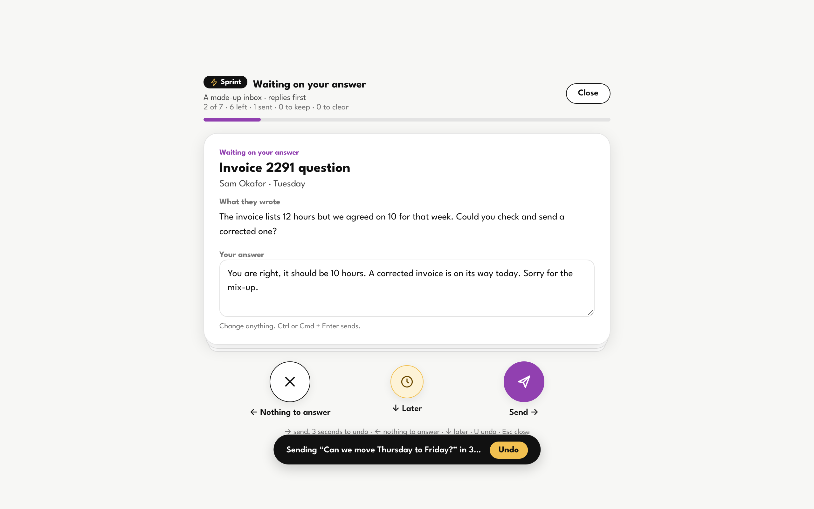

**A photo** fills the card. Pull it right or left: the stamp comes up as you
pull, and letting go past the mark answers.

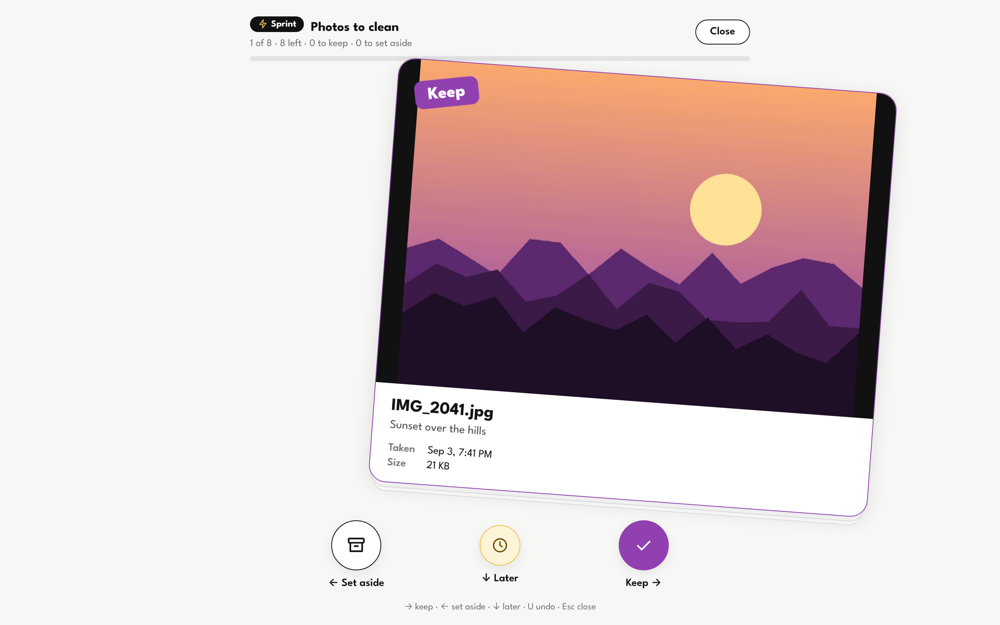

**A scored item** shows its number, a checklist of what was asked (met,
partly, not met) and a folded "Where things stand". The chips on top switch
which part of the pile you walk, until the first answer.

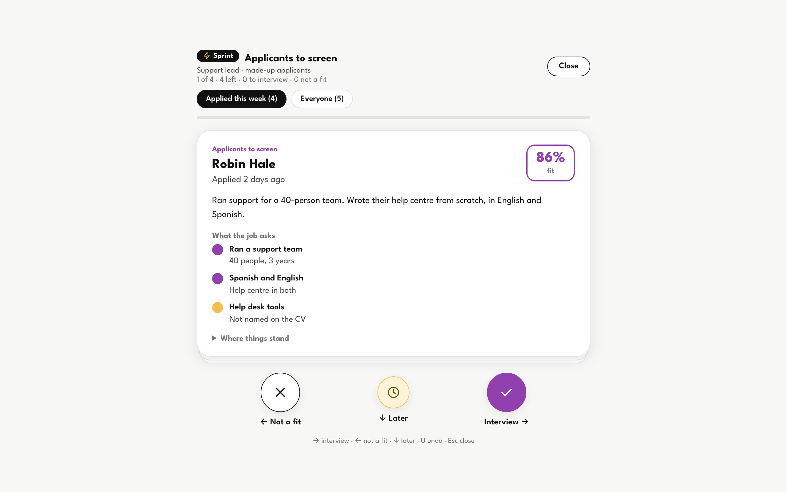

**Close early, or reach the end,** and it asks before anything happens:

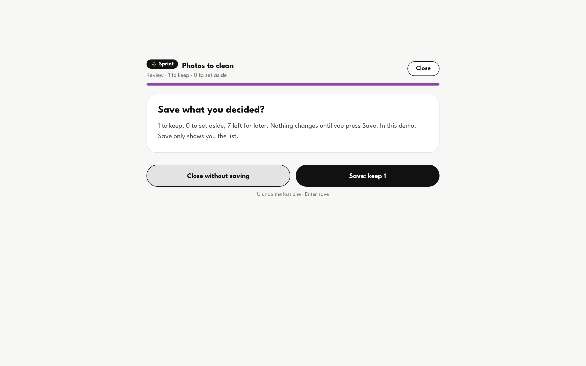

**After Save**, a clear pile says so. If some items did not save, it names
them and offers to try those again.

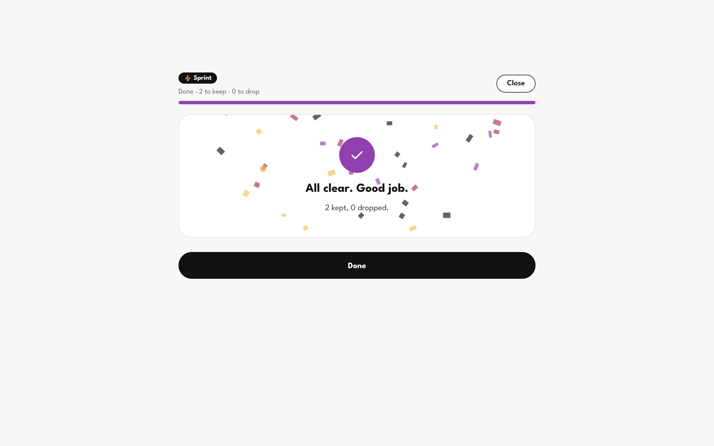

**On a phone** the card fills the screen and the answers stay under your thumb:

<p>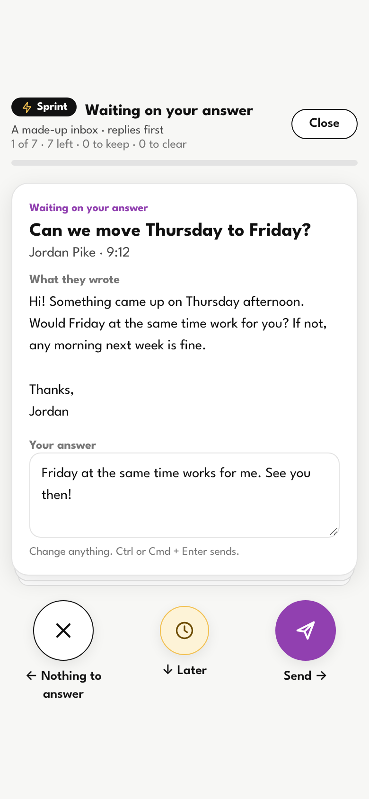 &nbsp; 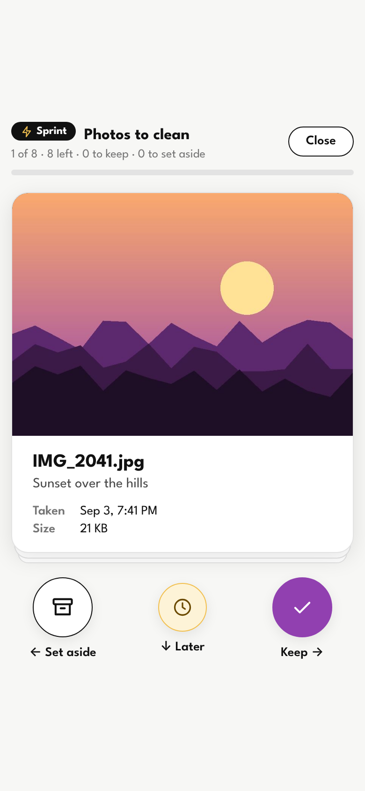 &nbsp; 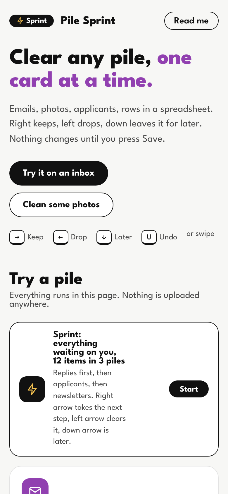</p>

## Everything it does

**Deciding**
- One card at a time, the whole item on it. Three answers: right, left, down (later).
- Keys, buttons, or a swipe with a mouse, trackpad or finger. The card follows the hand, a stamp with the answer comes up as you pull, and it flies off to the side it was answered (or down for later).
- Undo any press, back to the first. Close early and it asks whether to save what you decided.
- Each kind of item has its own title, words and marks on the answers. A word can depend on the item ("Send" once a draft is there, "Answer later" before). A kind can leave out an answer; that side then has no button and the card barely moves when pulled that way.
- One sprint can walk several piles, in the order you give (replies, then applicants, then newsletters).
- Chips on top switch which part of the pile is walked (Mine / Everyone), only before the first answer.
- The counter says where you are, how many are left, and how many of each answer; a bar fills as you go. An optional line under the title names the context (a project, a client, a date).

**On the card**
- Title (linked when the item has a link), subtitle, a small line of facts, and a number on the right (a fit, a score) coloured by how good it is.
- The full text, with its line breaks. Sections of text, lines of facts, a checklist (met, partly, not met), or a conversation. Any section can start folded.
- A picture, as large as the card allows.
- A box of words (a draft) the person can change before sending. Ctrl or Cmd + Enter sends from the box.
- "Open the original", also on the O key.

**Speed**
- `prepare(item)` gets what a card needs (a draft written, a conversation read) for this card and the next three while you read, so they are ready when they come up. Until then the card says "Getting this ready…" and right waits.
- Pictures of the next cards are loaded ahead.

**Doing**
- Answers wait on the card. One Save applies them: drops first, then keeps, with "Dropping 3 of 7…" as it goes.
- Or, for a kind marked `now`, right does it at once from the card (a send), held 3 seconds with Undo, counted apart, and left alone by Save. If it fails, it says so and the item goes back in the pile.
- Anything that did not save is named, with the reason, and can be tried again.
- A pile cleared to the last item, all saved, gets "All clear. Good job." and a short burst of confetti (once a day per pile; off with `celebrate: false` or "reduce motion").
- `onEvent` tells your page about every open, answer, undo, send, save and close, for your own usage numbers.

**Ways in and out**: arrays, JSON, CSV, your own URL, photo files or a whole folder; your own code per item, a webhook, a CSV or JSON file, moving files. See below.

## Keys and swipes

| Key | Swipe | Does |
|---|---|---|
| <kbd>→</kbd> or <kbd>Y</kbd> | right | Keep (or the kind's own word, like Send) |
| <kbd>←</kbd> or <kbd>N</kbd> | left | Drop (or the kind's own word) |
| <kbd>↓</kbd> or <kbd>S</kbd> | | Later: no answer, it stays as it is |
| <kbd>U</kbd> | | Undo the last press, or stop a send in its 3 seconds |
| <kbd>O</kbd> | | Open the original |
| <kbd>Ctrl</kbd>/<kbd>⌘</kbd> + <kbd>Enter</kbd> | | Send, from inside the words box |
| <kbd>Esc</kbd> | | Close. With answers, goes to the review first |
| <kbd>Enter</kbd> | | Save, on the review |

A swipe presses the button on that side of the card, so it can never do
something the button would not. Swiping works with a mouse, a trackpad or a
finger, and a mostly up-and-down move scrolls the card instead. With
"reduce motion" turned on, cards do not fly away.

## Items

An item is a plain object. Only `id` matters to Pile Sprint; the rest draws
the card.

```js
{
  id: "m1",                         // unique; missing ids become item-0, item-1...
  kind: "reply",                    // picks the labels from options.kinds
  title: "Can we move Thursday?",
  subtitle: "Jordan Pike · 9:12",
  image: "https://.../photo.jpg",   // http(s), blob: or a data: picture
  body: "The whole message...",     // shown in full, line breaks kept
  bodyLabel: "What they wrote",
  meta: "Added Monday · on the support list",       // a small line of facts
  badge: { value: "86%", label: "fit", tone: "ok" },  // tone: ok, mid or no
  fields: [["Size", "21 KB"], ["Taken", "Sep 3"]],   // or { Size: "21 KB" }
  sections: [
    { title: "What the job asks", checks: [{ label: "Spanish", tone: "ok", note: "Both" }] },
    { title: "The conversation", messages: [{ from: "Jordan", when: "9:12", text: "..." }, { from: "You", mine: true, text: "..." }] },
    { title: "Where things stand", folded: true, rows: [["Waiting", "3 days"]] }
  ],
  draft: { label: "Your answer", value: "Friday works!", note: "Change anything." },
  link: "https://...",              // the title links here; "Open the original ↗" and the O key
  payload: { anything: "else" }     // sent with the answer by the webhook
}
```

Everything on the card is shown as text. To draw a card your own way, pass
`render(item, { esc, labels, defaultCard })` and return an HTML string or a
DOM node; escaping is then up to you.

## Options

```js
PileSprint.open({
  items,                               // required
  title: "Inbox",                      // shown at the top
  context: "Support lead · Acme",       // a line under the title
  kinds: {                             // labels per item.kind; "default" for the rest
    reply: {
      title: "Waiting on your answer",
      keep: item => item.draft ? "Send" : "Answer later",   // a word, or a function of the item
      drop: "Nothing to answer",       // false leaves the answer out
      now: item => !!item.draft,       // right runs save.now at once, with Undo
      icons: { keep: "send", drop: "x" }   // check, x, send, pen, archive, star, trash
    },
    default: { keep: "Keep", drop: "Drop", later: "Later" }
  },
  order: ["reply", "applicant"],       // walk these kinds first, in this order
  views: [{ label: "Mine", items: mine }, { label: "Everyone", items: all }],   // instead of items
  prepare: async item => ({ draft: await writeDraft(item) }),   // merged into the item, 3 cards ahead
  preparingText: "Writing a draft…",
  save: { keep, drop, batch, now },    // see "Where the answers go"
  nowSeconds: 3,                       // the Undo window for now
  nowText: "Sending", nowDoneText: "Sent",
  saveNote: "Dropped photos move into Set aside.",   // added to the review
  counterWords: { keep: "to interview", drop: "not a fit" },
  badge: "Sprint",                     // the word in the black pill
  render: (item, h) => h.defaultCard(item, h.labels),
  readAhead: 3,                        // cards prepared and pictures loaded ahead
  celebrate: true, celebrateKey: "inbox",   // confetti on a cleared pile, once a day per key
  endTitle: "That was everyone.", doneLabel: "Back to the board", clearedText: r => "...",
  onEvent: (name, data) => {},         // open, view, decide, undo, now, save, saved, close
  container: document.body,
  className: "my-theme"
}) // -> Promise<{ saved, failed, later, decisions, closed }>
```

**A door for your page:** `PileSprint.startButton({ title, description, onStart })`
returns the wide button from the demo page, ready to append wherever the pile is.

**Theme it** by setting the CSS variables in `src/pile-sprint.css` on `:root`
or your `className`: `--ps-accent`, `--ps-later`, `--ps-ink`, `--ps-page`,
`--ps-card`, `--ps-font`, `--ps-width`. Dark mode follows the system, or
`data-theme="dark"` / `"light"` on `<html>`.

## Where a pile comes from

`src/sources.js` (`window.PileSprintSources`) turns common piles into items.

| Source | Use |
|---|---|
| `fromArray(list, mapFn?)` | Anything already in the page |
| `fromJSON(textOrValue)` | A JSON array, or `{ items: [...] }` |
| `fromCSV(text, map?)` | A spreadsheet. Columns named `id`, `title`/`name`/`subject`, `subtitle`/`from`, `body`/`notes`/`description`, `image`/`photo`, `link`/`url` and `kind`/`type` fill the card; every other column becomes a line. Pass `map` to name your own: `{ "Full name": "title" }` |
| `fromEndpoint(url, { token })` | Your own system. GETs JSON; the token goes in the `Authorization` header |
| `fromPhotoFiles(fileList)` | Photos from `<input type="file" multiple>`. Every browser, nothing uploaded |
| `fromPhotoFolder()` | A whole folder the browser may change (Chrome and Edge on a computer). Returns `{ items, dir }` for the folder destination |

## Where the answers go

`save` gets your handlers. Use any of the three:

- `drop(item)` and `keep(item)` run once per answered item, drops first.
  Return `false` or throw to mark that one item as not saved; the rest carry on.
- `batch(decisions)` runs once with every item and its answer, including
  `later`.
- `now(item, text)` runs from the card for a kind marked `now`, after its
  seconds to undo, with the words in the box. Return `false` or throw and the
  item goes back in the pile.
- With no handler, the promise simply returns the answers.

`src/destinations.js` (`window.PileSprintDestinations`) has ready-made ones:

| Destination | Does |
|---|---|
| `download({ format: "csv" \| "json" })` | Saves the answers as a file. CSV cells that start with `=`, `+`, `-` or `@` are made safe for spreadsheets |
| `webhook({ url, token, pile })` | POSTs the [`pile-sprint/1`](#the-pile-sprint1-format) JSON. Retries network errors and 5xx twice. Works with Zapier, Make, n8n, Apps Script or your own API |
| `folder(dir, { dropTo, keepTo })` | Moves dropped files into a `Set aside` folder (and kept ones into `keepTo`, if given). Never deletes |
| `both(a, b)` | Runs two destinations, for example move the photos and download the list |

Cleaning a photo folder is these two lines:

```js
const { items, dir } = await PileSprintSources.fromPhotoFolder();
await PileSprint.open({ title: dir.name, items, save: PileSprintDestinations.folder(dir) });
```

### Google Sheets

[`examples/google-sheets/Code.gs`](examples/google-sheets/Code.gs) turns a
sheet into a pile: its web app answers `GET` with the rows nobody decided yet
and writes each answer into a `decision` column on `POST`. Point
`fromEndpoint` and `webhook` at the web app's address, as in
[`examples/embed.html`](examples/embed.html).

Notion, Airtable, a CRM or an ATS work the same way: a small endpoint (or a
Zapier, Make or n8n flow) that returns the items and takes the answers.

## The `pile-sprint/1` format

What the webhook sends and the JSON download contains:

```json
{
  "format": "pile-sprint/1",
  "pile": "Inbox",
  "decided_at": "2026-11-14T18:30:00.000Z",
  "decisions": [
    { "id": "m1", "decision": "keep", "title": "Can we move Thursday to Friday?", "kind": "reply" },
    { "id": "m2", "decision": "drop", "title": "Your weekly digest" },
    { "id": "m3", "decision": "later", "title": "Invoice 2291 question" }
  ]
}
```

`decision` is `keep`, `drop`, `later`, or `now` for one already done from the card. Picture addresses are never sent.
An item's `payload`, if it has one, is sent as given.

## Privacy

No server, no account, no analytics. Pile Sprint sends nothing anywhere on
its own: the page's code chooses where the answers go, and only when Save is
pressed. Photos are shown from the browser's memory and never uploaded. See
[PRIVACY.md](PRIVACY.md).

## How it is built

| File | What it holds |
|---|---|
| `src/core.js` | The decisions with no screen: the session, undo, and running the save. Works in Node too |
| `src/pile-sprint.js` | The screen: cards, buttons, keys, swipes, review and result |
| `src/pile-sprint.css` | The look, all colours as CSS variables |
| `src/sources.js` | Ways in: arrays, JSON, CSV, an endpoint, photos |
| `src/destinations.js` | Ways out: download, webhook, folder |
| `index.html`, `examples/` | The demo page, made-up piles, the Sheets and embed examples |

Tested in Chromium. It uses nothing beyond standard browser features, so it
should work in current Firefox and Safari too, but they are not tested yet.
Opening a whole folder needs Chrome or Edge on a computer; elsewhere, pick
the photos instead and Save gives you the list.

## Test

```sh
npm install
npx playwright install chromium
npm test
```

19 checks in Node (decisions, undo, refused moves, kind order, sends that
cannot be undone, view switching, saving with failures, CSV, JSON, endpoint,
webhook retries, moving files) and 20 in real Chromium (keys, swipes, undo,
review, save, download, drafts written ahead, send with Undo, edited words
sent, Y/N/S, a score with checks and folds, view chips, the start bar, a
failed save tried again, the O key, a missing answer, confetti, text shown as
text, a CSV file, the phone width). See [CONTRIBUTING.md](CONTRIBUTING.md).

## Contributing

Bug reports, ideas for new sources and destinations, and pull requests are
welcome. Please read [CONTRIBUTING.md](CONTRIBUTING.md) and the
[Code of Conduct](CODE_OF_CONDUCT.md). Report security problems privately:
[SECURITY.md](SECURITY.md).

## Licence

[MIT](LICENSE). Use it, change it, ship it in your own product.
